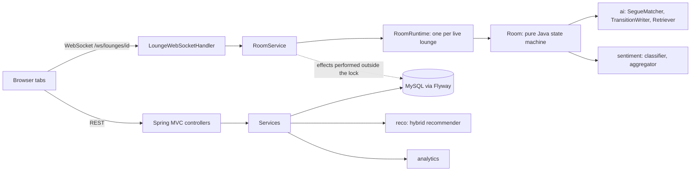
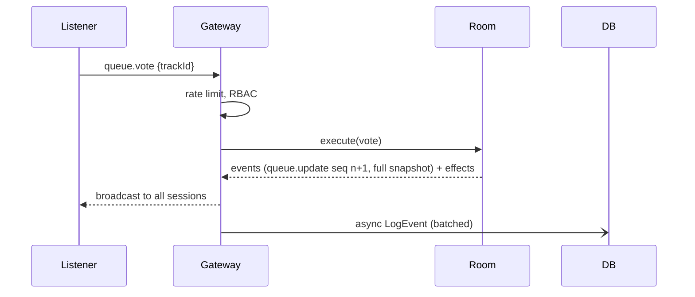
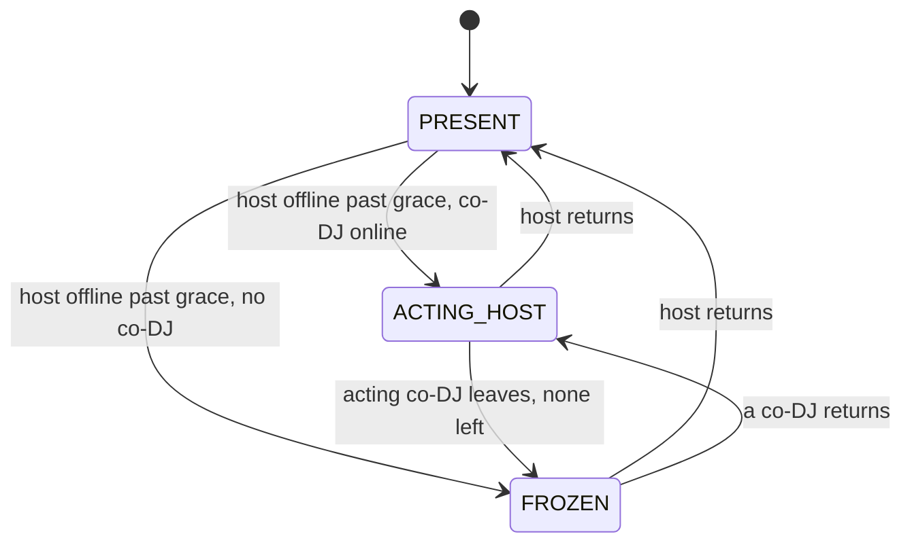

# Architecture

## Components

Key decision: each live lounge has one authoritative in-memory `Room`. All mutations go through
`RoomRuntime.execute` (single writer, synchronized); the room returns events and `Effect` records (data), and the
gateway persists them afterwards on a per-room single-thread executor. The room never touches a DB or socket, so every
rule is unit-testable.

## Sequence: vote on a queued track

## Host state machine

Frozen: queue mutations are rejected with `room_frozen`; chat and reactions still work.

## Data model (Flyway V1-V3)
users, refresh_tokens, tracks, track_timeline_events, dj_lounges, lounge_participants, queue_entries,
soundclash_battles, soundclash_candidates, chat_messages, interactions (V1); queue_events append-only log (V2);
analytics indexes (V3).

## AI DJ (no LLM)
- `SegueMatcher`: hard rules (BPM within 8% incl. half/double time, Camelot identical/adjacent/relative), then scored
  on energy fit and mood; recent-track penalty.
- `TransitionWriter`: template script built only from the two tracks' acoustic data and timeline events, with `sourceEvents` citations.
- `Retriever`: extractive Q&A over timeline notes, cites ids, declines when nothing matches.

## Sentiment
Per-message lexicon/emoji score in [0,1]; room mood = time-decayed average (30 s half-life, 120 s window, prior weight 1); trend = recent vs older half.

## Recommender
Content similarity (35/30/20/15 over bpm, key, energy, valence) blended with item-item cosine CF,
`w = 0.6 * min(1, n/3)`; popularity for cold start.
